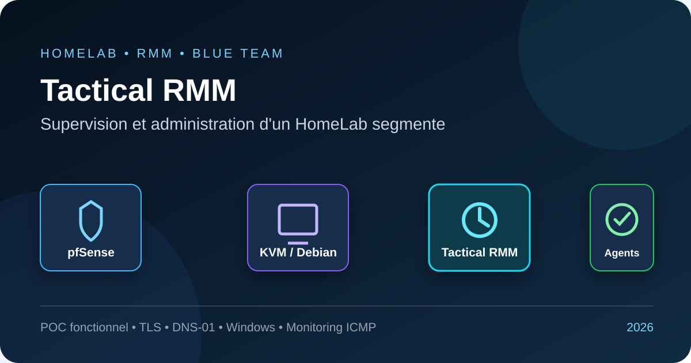
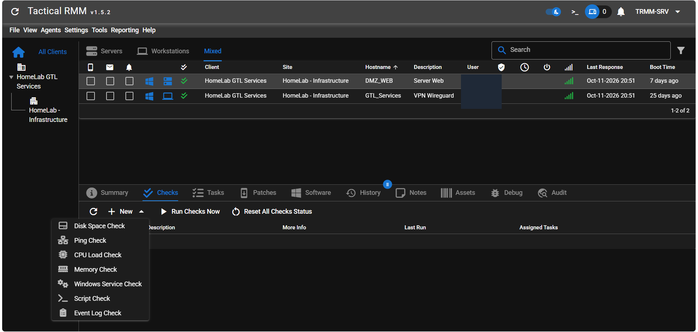
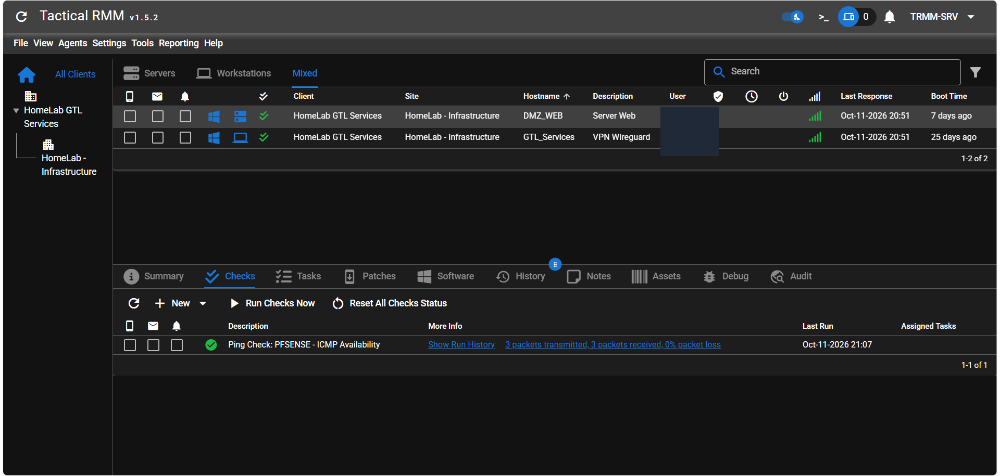

# Tactical RMM dans un HomeLab segmente

<p align="center">
  
</p>

[](https://github.com/amidaware/tacticalrmm)
[](VERSION)
[](docs/architecture.md)
[](report/PROJECT_REPORT.md)
[](docs/security.md)
[](LICENSE)

## Presentation

Ce depot documente l'integration de Tactical RMM dans un HomeLab protege par
pfSense et segmente en VLAN. Le serveur RMM est isole dans une VM Debian 12 sur
KVM/libvirt afin de preserver le serveur Wazuh deja en production sur l'hote
Ubuntu.

Le POC valide l'acces HTTPS, l'enrolement de deux agents Windows et la
supervision indirecte de pfSense par un controle ICMP execute depuis la DMZ.
Wazuh reste le SIEM du laboratoire ; Tactical RMM assure la supervision
operationnelle et l'administration des endpoints.



## Synthese

| Element | Valeur |
|---|---|
| Projet | `Tactical RMM HomeLab` |
| Solution | Tactical RMM v1.5.2 |
| Virtualisation | KVM/QEMU et libvirt sur Ubuntu 24.04 LTS |
| VM | Debian 12, 2 vCPU, 4 Gio de RAM, disque QCOW2 de 60 Gio |
| Securite reseau | pfSense, VLAN, routage controle et acces WireGuard |
| TLS | Certificat Let's Encrypt wildcard par challenge DNS-01 |
| Endpoints valides | 2 agents Windows |
| Supervision sans agent | Disponibilite ICMP de pfSense |
| Statut | POC fonctionnel, notifications e-mail a finaliser |
| Classification | `TLP:CLEAR` |

## Livrables

- [Rapport complet du projet](report/PROJECT_REPORT.md)
- [Architecture et flux](docs/architecture.md)
- [Procedure de deploiement](docs/deployment.md)
- [Supervision de pfSense](docs/monitoring.md)
- [Notifications Dashboard et e-mail](docs/notifications.md)
- [Incidents et depannage](docs/troubleshooting.md)
- [Limites et feuille de route](docs/limitations.md)
- [Securite de la publication](docs/security.md)
- [Inventaire des preuves](evidence/README.md)

## Architecture logique

```text
                         acces prive / WireGuard
                                   |
                            pfSense 192.168.20.1
                         routage et filtrage inter-VLAN
                         /            |             \
              VLAN 20 ADMIN     VLAN 30 DEV     VLAN 40 KALI
                    |                 |                |
        Ubuntu Admin / Wazuh       DMZ_WEB           Kali
        192.168.20.10                 |
              | KVM/libvirt           | agent Windows + Ping Check
              |                       +-----------> pfSense
              v
        VM Debian 12 TRMM
        reseau virtuel prive
              |
      rmm / api / mesh en HTTPS
```

Le schema detaille et les choix de cloisonnement sont presentes dans
[`docs/architecture.md`](docs/architecture.md).

## Resultats valides

- KVM, QEMU, libvirt et `/dev/kvm` operationnels sur l'hote Ubuntu.
- VM Debian 12 dediee au RMM, sans cohabitation avec Wazuh.
- Trois noms DNS distincts pour le frontend, l'API et MeshCentral.
- Certificat TLS wildcard obtenu par challenge DNS-01.
- Interface Tactical RMM accessible en HTTPS.
- Deux postes Windows enroles et visibles en ligne.
- Controle `PFSENSE - ICMP Availability` execute toutes les 300 secondes.
- Alerte configuree apres trois echecs consecutifs, severite `Warning`.



## Choix structurants

| Decision | Justification |
|---|---|
| VM dediee plutot qu'installation sur l'hote | Le script traditionnel exige un serveur vierge et pourrait casser Wazuh |
| Debian 12 | Systeme pris en charge par la documentation TRMM utilisee pendant le POC |
| 4 Gio de RAM | Minimum documente et compromis adapte aux 15 Gio de l'hote |
| DNS separe `rmm`, `api`, `mesh` | Prerequis de routage applicatif et de TLS de Tactical RMM |
| Certificat public par DNS-01 | HTTPS valide sans exposer temporairement un service HTTP |
| Ping depuis DMZ_WEB | pfSense n'est pas une cible classique de l'agent TRMM |
| TRMM et Wazuh complementaires | Operations et maintenance d'un cote, detection de securite de l'autre |

## Reproduction

La procedure complete est dans [`docs/deployment.md`](docs/deployment.md). Les
grandes phases sont :

1. Auditer les ressources, les ports et le support KVM de l'hote.
2. Installer KVM/QEMU, libvirt et Virt-Manager.
3. Creer une VM Debian 12 minimale et prendre un snapshot avant TRMM.
4. Configurer le routage, le DNS interne et les regles pfSense minimales.
5. Preparer `rmm`, `api` et `mesh` au meme niveau DNS.
6. Obtenir un certificat wildcard par challenge DNS-01.
7. Installer Tactical RMM avec le certificat valide.
8. Creer le client, le site et le fuseau horaire du laboratoire.
9. Enroler les agents Windows pilotes.
10. Creer et valider le controle ICMP de pfSense.
11. Configurer puis tester les notifications Dashboard et e-mail.

> Ne jamais reutiliser les valeurs de mot de passe, jetons, cles privees ou
> challenges ACME d'une capture. Ces donnees sont exclues du depot.

## Competences demontrees

- audit de capacite et analyse de compatibilite ;
- virtualisation KVM/QEMU et administration libvirt ;
- segmentation VLAN et filtrage pfSense ;
- DNS interne, TLS et challenge ACME DNS-01 ;
- deploiement et exploitation d'une plateforme RMM ;
- enrolement et supervision d'endpoints Windows ;
- monitoring sans agent et strategie d'alerting ;
- restauration QCOW2 et analyse d'incidents d'installation ;
- articulation entre RMM et SIEM ;
- documentation technique et publication responsable des preuves.

## Auteur

**Mounir KOUSKOUS**<br>
Operateur Cybersecurite | SOC Junior | Administration Systeme et Reseau<br>
[LinkedIn](https://www.linkedin.com/in/mounir-kouskous/)

## Avertissement

Ce projet decrit un laboratoire controle. Les adresses privees appartiennent aux
plages RFC 1918. Tactical RMM donne des capacites d'administration puissantes :
son utilisation doit etre limitee aux equipements possedes ou explicitement
autorises, avec authentification forte, droits minimaux et journalisation.
