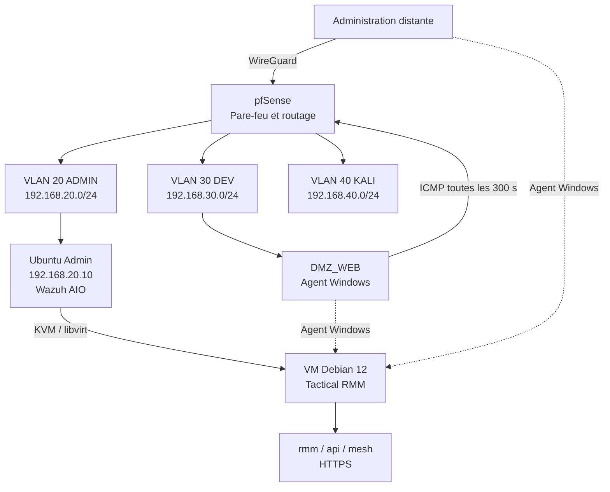

# Architecture du projet

## Contexte initial

L'hote physique est un ASUS GL553VD sous Ubuntu 24.04 LTS. Il heberge deja un
Wazuh All-in-One, CrowdSec, CUPS et d'autres services du laboratoire. L'audit a
montre quatre coeurs CPU, 15 Gio de RAM, environ 375 Gio disponibles et une
charge tres faible au moment de la mesure.

L'installation traditionnelle de Tactical RMM suppose un serveur Linux vierge.
Une installation directe sur l'hote aurait introduit des conflits possibles
avec Nginx, HTTPS, les services Wazuh et les dependances de l'installateur. Le
choix retenu est donc une VM dediee sur le meme materiel.

## Vue logique

La source Mermaid est disponible dans
[`../diagrams/architecture.mmd`](../diagrams/architecture.mmd).

## Composants

| Composant | Role | Etat du POC |
|---|---|---|
| pfSense | Routage, filtrage inter-VLAN, WireGuard | Existant et operationnel |
| Ubuntu Admin | Hote KVM et serveur Wazuh AIO | Existant et preserve |
| KVM/QEMU | Acceleration de la VM | Valide |
| libvirt | Cycle de vie et reseau de la VM | Valide |
| Debian 12 | Systeme invite dedie | Valide |
| Tactical RMM | Supervision et administration distante | Valide en v1.5.2 |
| MeshCentral | Controle distant integre | Installe avec TRMM |
| Wazuh | SIEM et detection de securite | Maintenu separement |
| DMZ_WEB | Agent Windows et sonde ICMP | Valide |

## Dimensionnement de la VM

| Ressource | Valeur |
|---|---|
| Systeme | Debian 12 minimal x86-64 |
| vCPU | 2 |
| RAM | 4 Gio |
| Disque | 60 Gio QCOW2, allocation dynamique |
| Administration invite | SSH restreint |
| Exposition applicative | HTTPS uniquement selon les besoins du laboratoire |

Ce dimensionnement vise un petit nombre d'agents et de checks. Il ne constitue
pas un dimensionnement de production.

## Adressage documente

| Zone | Sous-reseau | Exemple de cible |
|---|---|---|
| ADMIN | `192.168.20.0/24` | pfSense `192.168.20.1`, hote `192.168.20.10` |
| DEV | `192.168.30.0/24` | DMZ_WEB `192.168.30.10` |
| KALI | `192.168.40.0/24` | poste de test autorise |
| WireGuard | `10.10.10.0/24` | administration distante |
| libvirt | reseau prive RFC 1918 | VM Tactical RMM |

L'adresse exacte de la VM et les enregistrements DNS internes doivent etre
adaptes a chaque deploiement. Le depot n'a pas vocation a publier une
configuration pfSense directement importable.

## Nommage DNS

Tactical RMM utilise trois noms au meme niveau DNS :

| Service | Modele publie |
|---|---|
| Frontend | `rmm.homelab.example.tld` |
| API | `api.homelab.example.tld` |
| MeshCentral | `mesh.homelab.example.tld` |

Le domaine reel est visible dans certaines preuves historiques, mais les
procedures utilisent volontairement `example.tld`. Les agents doivent resoudre
les trois noms vers l'adresse joignable de la VM.

## Flux minimaux

| Source | Destination | Protocole | Usage |
|---|---|---|---|
| Administrateur autorise | Frontend TRMM | TCP 443 | Interface d'administration |
| Agents | `rmm`, `api`, `mesh` | TCP 443 | Agent, API et controle distant |
| Administrateur | VM Debian | TCP 22 | Maintenance SSH restreinte |
| DMZ_WEB | pfSense | ICMP | Controle de disponibilite |
| VM Debian | DNS/NTP/depots autorises | Sortant | Resolution, heure et mises a jour |

Les regles `any -> any` ne sont pas recommandees. Les flux doivent etre limites
aux sources, destinations et services necessaires.

## Separation TRMM / Wazuh

| Tactical RMM | Wazuh |
|---|---|
| disponibilite et etat operationnel | collecte et correlation d'evenements |
| inventaire materiel et logiciel | detection de menaces et FIM |
| checks, taches et scripts controles | investigation SOC et MITRE ATT&CK |
| assistance et maintenance distante | alertes de securite |

Cette separation reduit les conflits techniques et evite de confondre un outil
d'administration avec un outil de detection.
