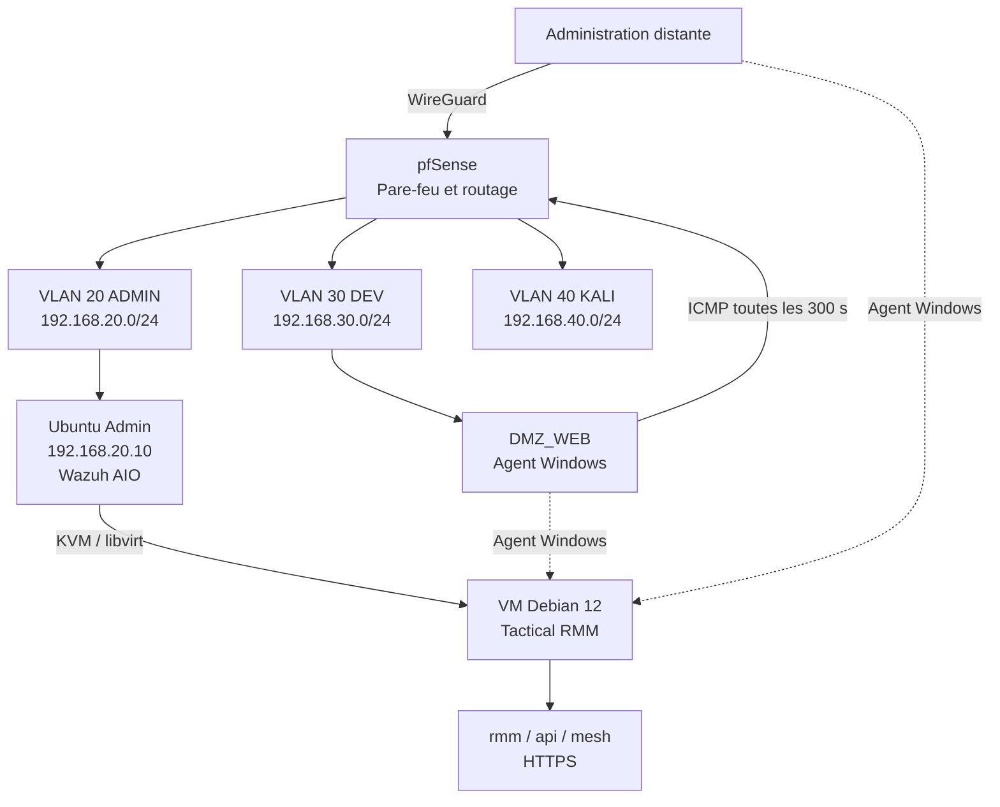

# Architecture du projet

## Contexte initial

L'hôte physique est un ASUS GL553VD sous Ubuntu 24.04 LTS. Il héberge déjà un
Wazuh All-in-One, CrowdSec, CUPS et d'autres services du laboratoire. L'audit a
montré quatre cœurs CPU, 15 Gio de RAM, environ 375 Gio disponibles et une
charge très faible au moment de la mesure.

L'installation traditionnelle de Tactical RMM suppose un serveur Linux vierge.
Une installation directe sur l'hôte aurait introduit des conflits possibles
avec Nginx, HTTPS, les services Wazuh et les dépendances de l'installateur. Le
choix retenu est donc une VM dédiée sur le même matériel.

## Vue logique

La source Mermaid est disponible dans
[`../diagrams/architecture.mmd`](../diagrams/architecture.mmd).

## Composants

| Composant | Rôle | État du POC |
|---|---|---|
| pfSense | Routage, filtrage inter-VLAN, WireGuard | Existant et opérationnel |
| Ubuntu Admin | Hôte KVM et serveur Wazuh AIO | Existant et préservé |
| KVM/QEMU | Accélération de la VM | Validé |
| libvirt | Cycle de vie et réseau de la VM | Validé |
| Debian 12 | Système invité dédié | Validé |
| Tactical RMM | Supervision et administration distante | Validé en v1.5.2 |
| MeshCentral | Contrôle distant intégré | Installé avec TRMM |
| Wazuh | SIEM et détection de sécurité | Maintenu séparément |
| DMZ_WEB | Agent Windows et sonde ICMP | Validé |

## Dimensionnement de la VM

| Ressource | Valeur |
|---|---|
| Système | Debian 12 minimal x86-64 |
| vCPU | 2 |
| RAM | 4 Gio |
| Disque | 60 Gio QCOW2, allocation dynamique |
| Administration de l'invité | SSH restreint |
| Exposition applicative | HTTPS uniquement selon les besoins du laboratoire |

Ce dimensionnement vise un petit nombre d'agents et de checks. Il ne constitue
pas un dimensionnement de production.

## Adressage documenté

| Zone | Sous-réseau | Exemple de cible |
|---|---|---|
| ADMIN | `192.168.20.0/24` | pfSense `192.168.20.1`, hôte `192.168.20.10` |
| DEV | `192.168.30.0/24` | DMZ_WEB `192.168.30.10` |
| KALI | `192.168.40.0/24` | poste de test autorisé |
| WireGuard | `10.10.10.0/24` | administration distante |
| libvirt | réseau privé RFC 1918 | VM Tactical RMM |

L'adresse exacte de la VM et les enregistrements DNS internes doivent être
adaptés à chaque déploiement. Le dépôt n'a pas vocation à publier une
configuration pfSense directement importable.

## Nommage DNS

Tactical RMM utilise trois noms au même niveau DNS :

| Service | Modèle publié |
|---|---|
| Frontend | `rmm.homelab.example.tld` |
| API | `api.homelab.example.tld` |
| MeshCentral | `mesh.homelab.example.tld` |

Le domaine réel est visible dans certaines preuves historiques, mais les
procédures utilisent volontairement `example.tld`. Les agents doivent résoudre
les trois noms vers l'adresse joignable de la VM.

## Flux minimaux

| Source | Destination | Protocole | Usage |
|---|---|---|---|
| Administrateur autorisé | Frontend TRMM | TCP 443 | Interface d'administration |
| Agents | `rmm`, `api`, `mesh` | TCP 443 | Agent, API et contrôle distant |
| Administrateur | VM Debian | TCP 22 | Maintenance SSH restreinte |
| DMZ_WEB | pfSense | ICMP | Contrôle de disponibilité |
| VM Debian | DNS/NTP/dépôts autorisés | Sortant | Résolution, heure et mises à jour |

Les règles `any -> any` ne sont pas recommandées. Les flux doivent être limités
aux sources, destinations et services nécessaires.

## Séparation TRMM / Wazuh

| Tactical RMM | Wazuh |
|---|---|
| disponibilité et état opérationnel | collecte et corrélation d'événements |
| inventaire matériel et logiciel | détection de menaces et FIM |
| checks, tâches et scripts contrôlés | investigation SOC et MITRE ATT&CK |
| assistance et maintenance distante | alertes de sécurité |

Cette séparation réduit les conflits techniques et évite de confondre un outil
d'administration avec un outil de détection.
