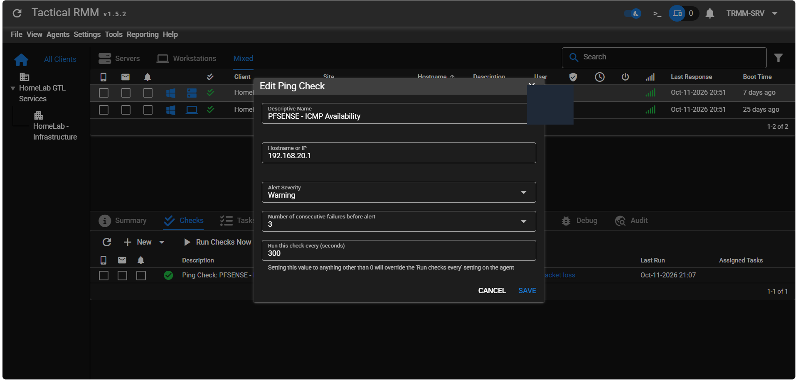

# Supervision de pfSense

## Objectif

pfSense n'étant pas une cible classique de l'agent Tactical RMM, sa
disponibilité est contrôlée indirectement depuis l'agent Windows `DMZ_WEB`,
situé dans le HomeLab.

Avant l'automatisation, quatre requêtes ICMP ont confirmé la connectivité de
`DMZ_WEB` vers `192.168.20.1`, avec des temps de réponse de 2 à 3 ms lors du
test ponctuel.

## Check validé

| Paramètre | Valeur |
|---|---|
| Type | Ping Check natif |
| Nom | `PFSENSE - ICMP Availability` |
| Cible | `192.168.20.1` |
| Agent exécutant | `DMZ_WEB` |
| Intervalle | 300 secondes |
| Sévérité | `Warning` |
| Échecs avant alerte | 3 |

## Création dans Tactical RMM

1. Ouvrir le client et le site du HomeLab.
2. Sélectionner l'agent `DMZ_WEB`.
3. Ouvrir `Checks`.
4. Choisir `New > Ping Check`.
5. Renseigner les paramètres du tableau.
6. Enregistrer puis utiliser `Run Checks Now`.
7. Confirmer la coche verte et consulter `Show Run History`.

Le résultat validé affiche trois paquets émis, trois reçus et aucune perte.

## Interprétation

Un état vert confirme uniquement que l'interface pfSense cible répond depuis
`DMZ_WEB`. Il ne prouve pas que :

- l'accès WAN fonctionne ;
- le tunnel WireGuard est disponible ;
- le DNS répond correctement ;
- toutes les interfaces VLAN sont opérationnelles ;
- le pare-feu dispose de ressources suffisantes.

## Dépendances et faux positifs

Le check dépend de l'agent `DMZ_WEB`, de Windows, du VLAN DEV et du routage
inter-VLAN. Si cet agent est hors ligne, le contrôle ne permet pas de conclure
que pfSense est en panne.

Une supervision plus robuste doit utiliser une seconde sonde indépendante et
corréler :

- le statut de l'agent exécutant ;
- un second ping depuis une autre zone ;
- un contrôle HTTPS de l'interface d'administration, si autorisé ;
- des métriques SNMP restreintes ;
- les journaux pfSense déjà exploités par Wazuh.

## Contrôles suivants proposés

| Contrôle | Cible | Statut |
|---|---|---|
| ICMP Ubuntu Admin | `192.168.20.10` | À planifier |
| HTTPS Wazuh | hôte Admin, TCP 443 | À planifier |
| Wazuh Manager | hôte Admin, TCP 1514 | À planifier |
| ICMP Kali | `192.168.40.10` | À planifier |
| DNS pfSense | requête DNS réelle | À planifier |
| SNMP pfSense | CPU, RAM, interfaces | À étudier |

Un simple contrôle TCP 53 ne valide pas une résolution DNS. Un check de service
doit tester le comportement attendu, pas seulement l'ouverture du port.
